# Elvezet: booking platform for barbers and salons

Elvezet lets people in Addis Ababa find a barber, salon or beauty
professional, book a time, pay by bank transfer, and show a QR ticket at the
door. Shops get the other side: a booking calendar, walk-ins, staff
schedules, client history, earnings and SMS alerts, on the phone or on the web.

This repository holds the **backend API** and the **web dashboard** (owners
and platform admins). The **customer app** and the **business/staff app** are
Flutter apps in separate repositories. They are shown below because they run
on this API.

<p>
  <a href="docs/INSTALLATION.md">Installation</a> ·
  <a href="docs/ARCHITECTURE.md">Architecture</a> ·
  <a href="docs/ENVIRONMENT.md">Environment</a> ·
  <a href="docs/API_ENDPOINTS.md">API endpoints</a> ·
  <a href="API_REFERENCE.md">API reference</a>
</p>

## Screenshots

### Customer app

<table>
  <tr>
    <td align="center">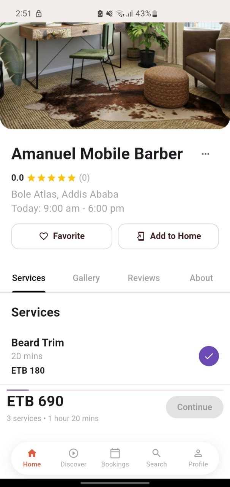<br><sub>Shop page: pick services, see the total</sub></td>
    <td align="center">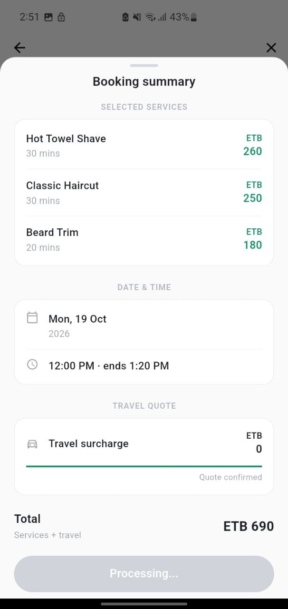<br><sub>Booking summary in ETB</sub></td>
    <td align="center">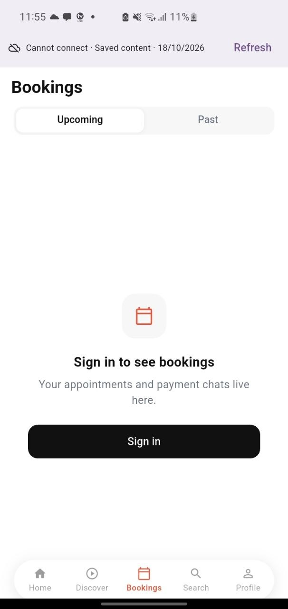<br><sub>Bookings, with offline banner</sub></td>
  </tr>
</table>

### Business / staff app

<a href="docs/media/staff-app-demo.mp4"><b>▶ Watch the 2-minute staff app demo</b></a> (MP4, 2.3 MB)

<table>
  <tr>
    <td align="center">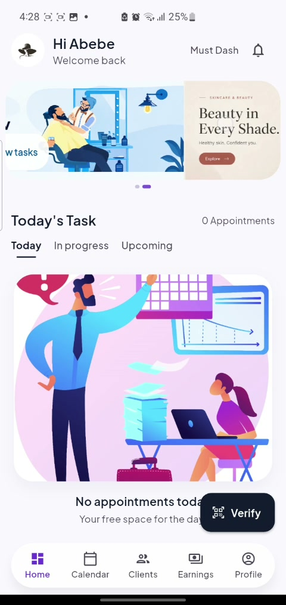<br><sub>Today's tasks</sub></td>
    <td align="center">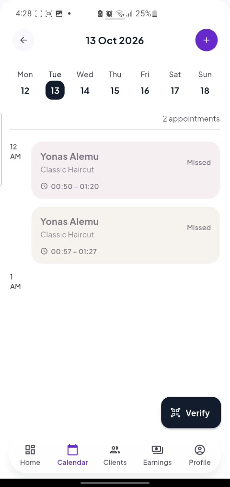<br><sub>Calendar</sub></td>
    <td align="center">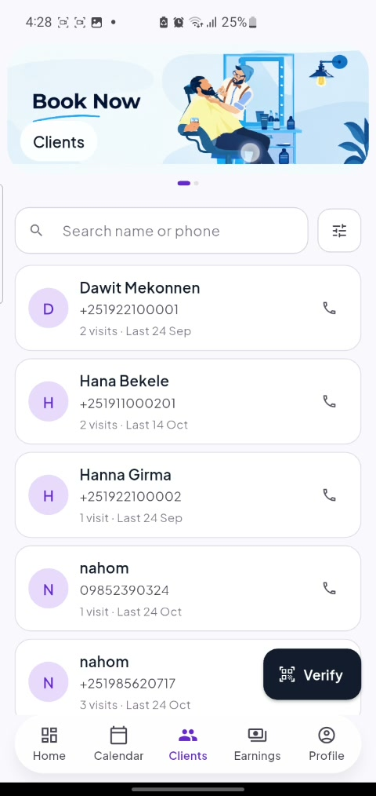<br><sub>Clients</sub></td>
    <td align="center">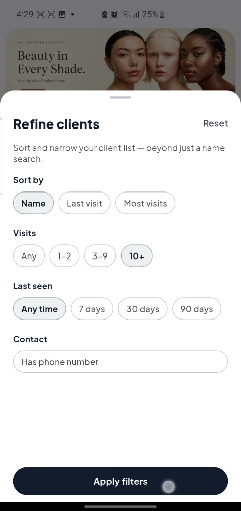<br><sub>Client filters</sub></td>
  </tr>
  <tr>
    <td align="center">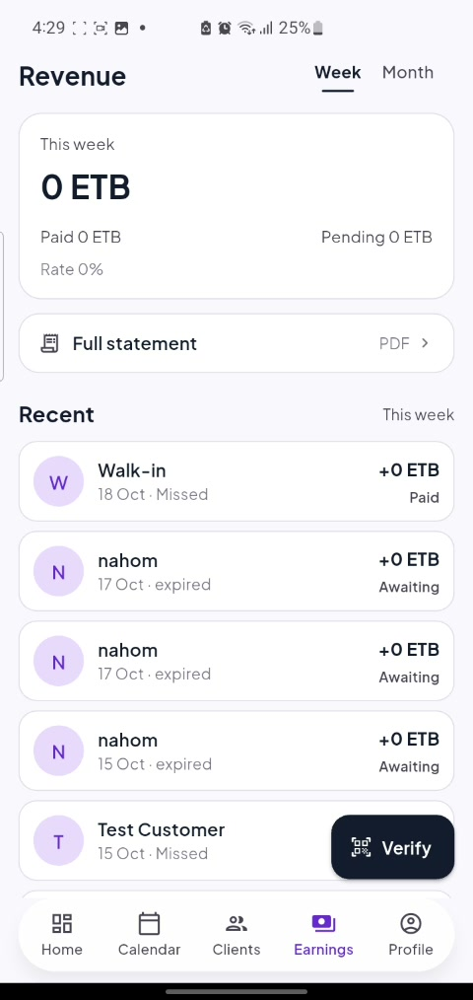<br><sub>Earnings</sub></td>
    <td align="center">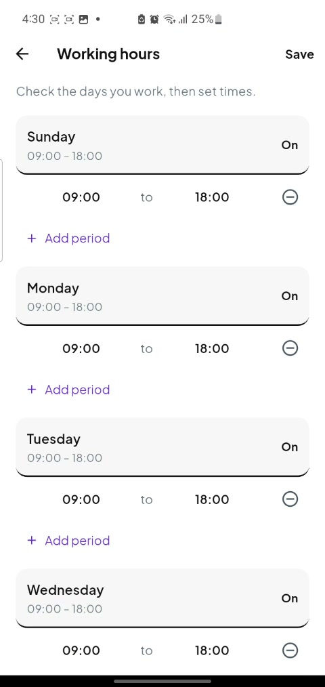<br><sub>Working hours</sub></td>
    <td align="center">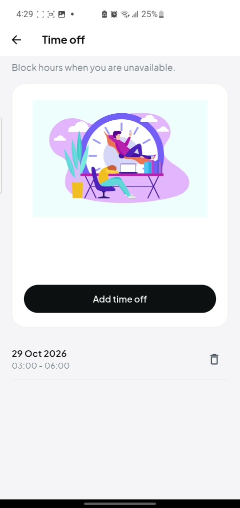<br><sub>Time off</sub></td>
    <td align="center">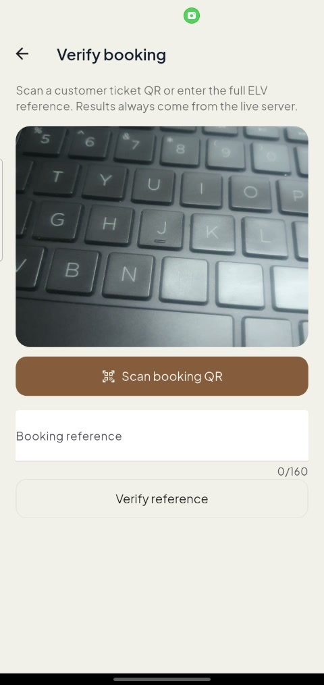<br><sub>Verify a booking QR</sub></td>
  </tr>
</table>

### Web dashboard (this repo)

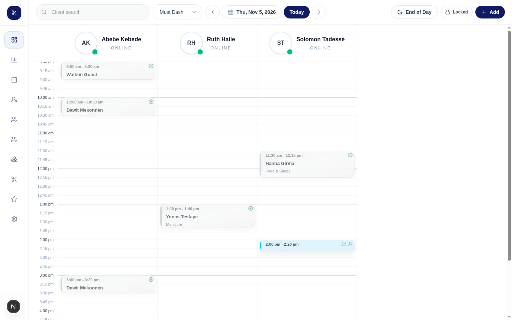

<sub>The owner's booking calendar for the demo shop, running locally on seed data.</sub>

### Early design

An earlier version of the customer app. It used placeholder data (US
addresses, dollar prices, stock names and photos), not real shops.

<table>
  <tr>
    <td align="center">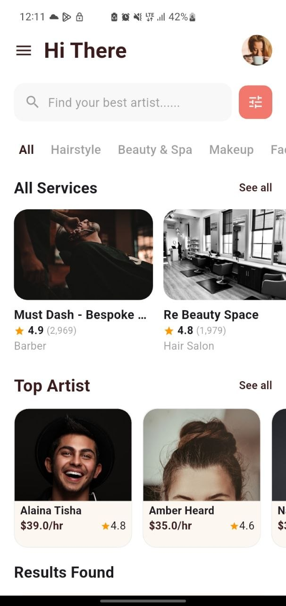<br><sub>Home</sub></td>
    <td align="center">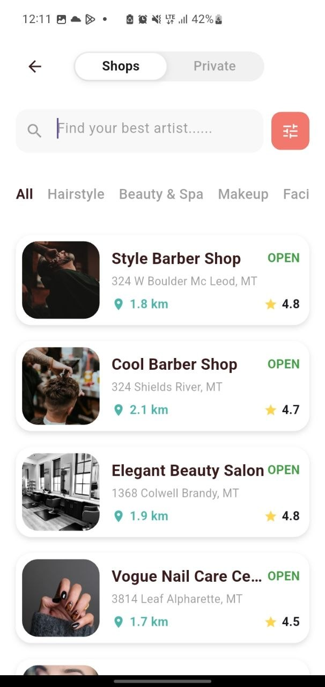<br><sub>Shops nearby</sub></td>
  </tr>
</table>

## What it does

- **Booking**: availability by staff member, a short slot hold while the customer books,
  rescheduling, cancellation window, automatic no-shows, walk-ins.
- **Payments**: customers pay by bank transfer and upload the receipt. The API
  checks it with [Verify.ET](https://verify.et) (exact amount, receiving
  account, unused reference) before confirming.
- **Tickets**: each paid booking gets a QR ticket that staff scan at the shop.
- **Messaging**: booking chat between customer and shop, push notifications
  (Firebase), reminders, and shop SMS alerts (SMS Ethiopia).
- **Shop management**: staff, working hours, time off, commissions, services,
  products and stock, clients and notes, earnings and payouts, analytics.
- **Marketplace**: shops, salons and independent professionals; categories;
  reviews; a Discover video feed; favorites.
- **Offline**: the web dashboard keeps working and queues walk-ins while offline.
- **Admin**: business applications, verification, users, categories, content
  safety reports, account deletion requests.

## Quick start

You need Node.js 20+ and a MongoDB **replica set** (a free MongoDB Atlas
cluster works). Full guide, including Docker: [docs/INSTALLATION.md](docs/INSTALLATION.md).

```bash
git clone https://github.com/abimtad/AI-ML.git && cd AI-ML

# API
npm ci
cp .env.example .env          # set MONGO_URI; see docs/ENVIRONMENT.md
npm run seed:mustdash         # demo shop, staff, clients and bookings
npm run dev                   # http://localhost:5000  (curl /health)

# Web dashboard (second terminal)
cd frontend && npm ci
printf 'NEXT_PUBLIC_API_URL=http://localhost:5000/api/v1\nNEXTAUTH_URL=http://localhost:3000\nNEXTAUTH_SECRET=change-me\n' > .env.local
npm run dev                   # http://localhost:3000, then "Login as Test Owner"
```

These steps were run end to end on 2026-11-05. The API starts without Redis
or a real Firebase project (it warns and skips queues and real sign-in), which
is enough to try the dashboard.

## How it fits together

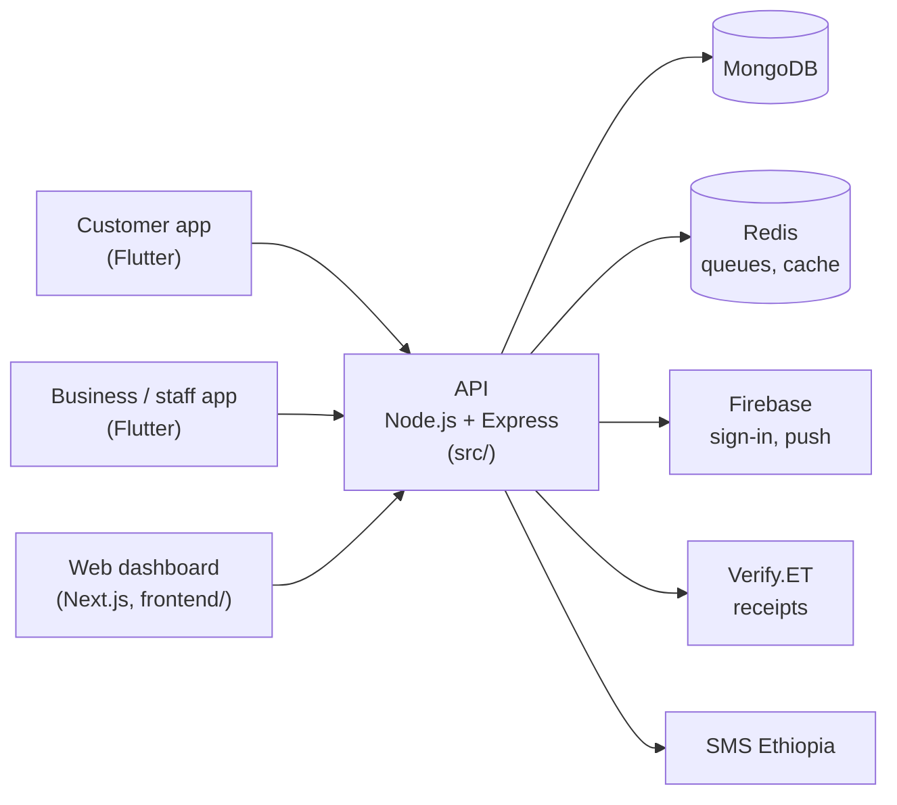

More detail, including the booking and payment flow:
[docs/ARCHITECTURE.md](docs/ARCHITECTURE.md).

## Tech stack

| Part | Built with |
|---|---|
| API (`src/`) | Node.js, Express 5, TypeScript, MongoDB + Mongoose, Redis + BullMQ, Socket.IO, Firebase Admin, Joi, Sharp |
| Web dashboard (`frontend/`) | Next.js 16, React 19, Tailwind CSS 4, NextAuth, TanStack Query, Socket.IO client |
| Mobile apps (separate repos) | Flutter |
| Hosting | API on Render, database on MongoDB Atlas |

## Repository layout

| Path | What's there |
|---|---|
| [`src/`](src/README.md) | The API. [Backend README](src/README.md). |
| [`frontend/`](frontend/README.md) | Owner dashboard and admin console. [Frontend README](frontend/README.md). |
| `docs/` | Installation, architecture, environment, endpoint list, screenshots, demo video. |
| `API_REFERENCE.md` | Request and response bodies for the main endpoints. |
| `BOOKING_RECEIPT_FLOW.md`, `SMS_NOTIFICATIONS.md`, `WEBSITE_OFFLINE.md`, `PRIVACY_SAFETY_RELEASE.md` | Notes on individual features. |
| `uploads/` | Demo images used by the seed scripts and served by the API. |
| `demo-output/` | Logins for the demo marketplace, written by `npm run seed:demo-marketplace`. |
| `docker-compose.yml` | Local MongoDB and Redis. |

## Known gaps

- **Mobile apps are not in this repo.** Their code and READMEs live in their
  own repositories.
- **Demo passwords are committed.** `demo-output/` holds the email and
  password of every demo business owner. They are fake `@barberos.demo`
  accounts, but anyone can read them, so never seed them into a database that
  real users rely on.
- **No single test command.** Tests are separate `npm run test:*` scripts and
  need a database.
- **Uploads live on the server's disk.** Cloudinary settings exist but are not
  wired up.
- **Chapa checkout is retired.** Its endpoints still answer, always with
  `410 Gone`.
- **Docker setup needs a manual step** (initiating the MongoDB replica set),
  described in the installation guide.

## License

[MIT](LICENSE)
