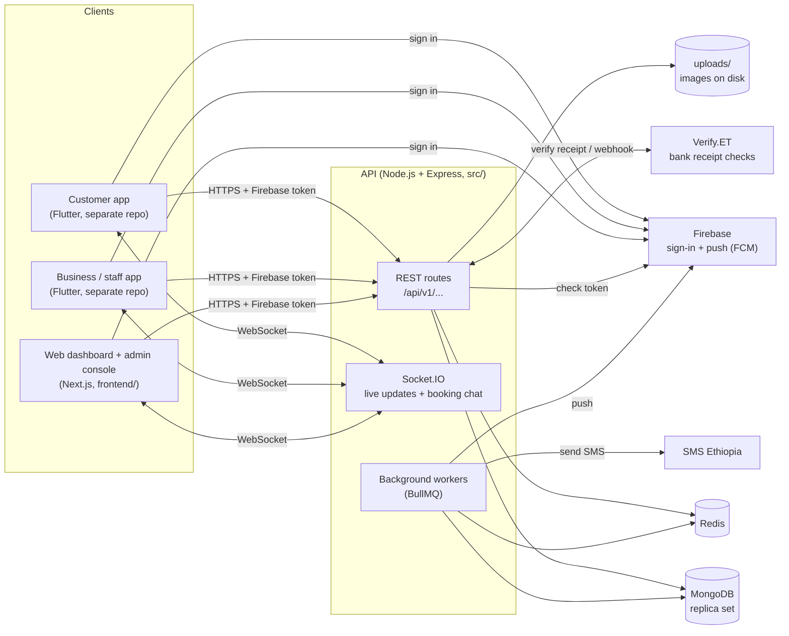
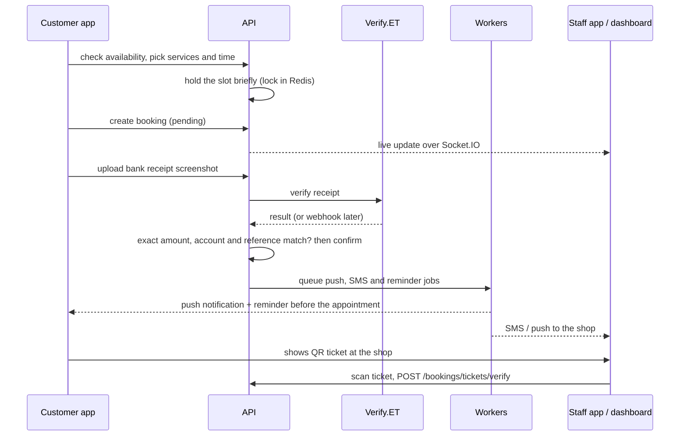

# Architecture

How the parts of Elvezet fit together: which apps exist, what the API does
for them, and which outside services it relies on.

## The big picture

Every client talks to the same API. Nothing talks to the database directly.

## The clients

| Client | Who uses it | Where it lives |
|---|---|---|
| **Customer app** | People booking haircuts and beauty services: browse shops, book, pay, chat with the shop, show a booking ticket. | Separate Flutter repository |
| **Business / staff app** | Barbers, stylists and shop owners on their phones: today's tasks, calendar, clients, earnings, working hours, time off, and scanning customers' booking QR codes. | Separate Flutter repository |
| **Web dashboard** | Shop owners at a desk: booking grid, walk-ins, staff, services, inventory, clients, analytics, payments and SMS settings. Works offline for walk-ins. | `frontend/` |
| **Admin console** | Platform staff: approve business applications, verification queue, users, categories, Discover videos, safety reports, SMS. | `frontend/` under `/admin` |

## Who can do what

Each user has one or more roles: `customer`, `staff`, `owner`, `admin`,
`moderator`. A shop is a `Business`. Staff are linked to shops through staff
profiles, and one person can work at more than one shop. There are also
**independent professionals**: people who work alone, without a shop, under
`/api/independent`.

## How a request is handled

1. The client signs in with **Firebase** and sends the ID token as
   `Authorization: Bearer <token>`.
2. The API checks the token with Firebase Admin and loads (or creates) the
   matching user in MongoDB. In `development` only, the `x-dev-user-id`
   header can stand in for a token.
3. Rate limits run first (stored in Redis, with an in-memory fallback).
4. The route checks the role or ownership (for example, only the owner of
   `:shopId` can use `/api/dashboard/:shopId/...`).
5. Input is validated with Joi. Then a service does the work in MongoDB.
6. The response always has the same shape:
   `{ "status": "success", "data": ... }` or
   `{ "status": "error", "message": ..., "data": null }`.

Code layout follows that path: `routes/` then `middlewares/` then
`validators/` then `controllers/` then `services/` then `models/`.

## A booking, end to end

Details live in [`BOOKING_RECEIPT_FLOW.md`](../BOOKING_RECEIPT_FLOW.md).
Chapa online checkout used to exist. Its endpoints now answer
`410 Gone` with a message to upload a receipt instead.

## Background work

Workers start with the API process when Redis is reachable (`src/jobs/`):

| Queue | Job |
|---|---|
| `notifications` | Push notifications through Firebase Cloud Messaging. |
| `reminders` | Appointment reminders (`REMINDER_LEAD_MINUTES` before). |
| `sms` | Shop SMS through SMS Ethiopia, with quotas and retries. |
| `booking-expiry` | Releases pending bookings that were never paid. |

The API process also runs a no-show sweep every few minutes, a recovery loop
that re-sends notification events that failed to queue, and the account
deletion cleanup. If Redis is down at startup, the API still serves requests
but none of the queued work runs.

## Live updates

Socket.IO shares the API's port. It is used for:

- **Realtime refresh**: dashboards and apps refresh bookings when something
  changes.
- **Booking chat**: `join-chat` / `send-message` between a customer and the
  shop, stored in MongoDB.

## Offline mode (web dashboard)

The dashboard uses a service worker and IndexedDB. Owners can keep seeing
saved data and queue walk-ins and edits while offline. When they're back
online, the queue is replayed through `/api/website-sync`, and conflicts are
shown to the owner instead of being overwritten. See
[`WEBSITE_OFFLINE.md`](../WEBSITE_OFFLINE.md).

## Files and media

Uploads are stored on the API server's disk under `uploads/` and served at
`/uploads/...`. Payment receipts (`booking-screenshots/`) and ID cards
(`id-cards/`) are private: only the customer, the shop, or moderators can open
them. `uploads/` in the repo holds demo images used by the seed scripts.

## Hosting

- **API**: Render (`RENDER=true` makes it trust Render's proxy for client IPs).
- **Database**: MongoDB Atlas.
- **Redis**: any Redis 7 over TCP (for example Upstash).
- The web dashboard is a standard Next.js app. Where it is deployed is not
  recorded in this repo.

## Other docs

- [`INSTALLATION.md`](INSTALLATION.md): run everything locally.
- [`ENVIRONMENT.md`](ENVIRONMENT.md): every setting.
- [`API_ENDPOINTS.md`](API_ENDPOINTS.md): every endpoint.
- [`../API_REFERENCE.md`](../API_REFERENCE.md): request and response bodies.
- [`../SMS_NOTIFICATIONS.md`](../SMS_NOTIFICATIONS.md), [`../PRIVACY_SAFETY_RELEASE.md`](../PRIVACY_SAFETY_RELEASE.md): feature notes.
