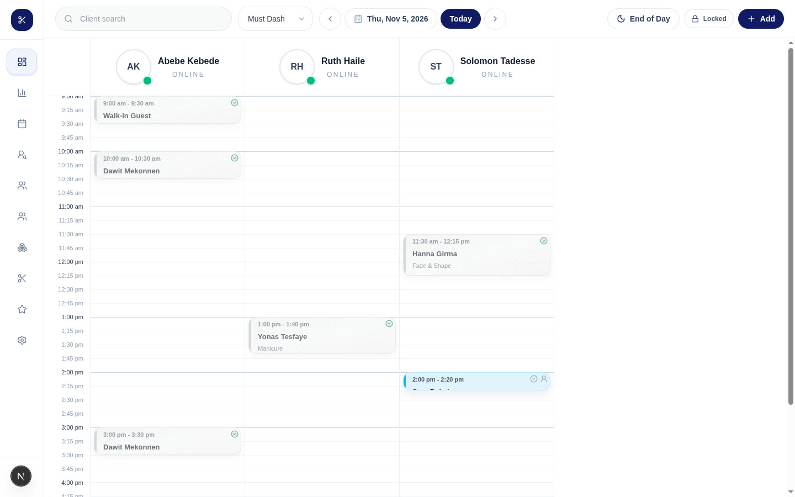

# Web dashboard and admin console

The Elvezet website for **shop owners** (run the shop from a desk) and for
**platform admins** (run the marketplace). Built with Next.js 16 (App Router),
React 19, Tailwind CSS 4, NextAuth and TanStack Query. It talks only to the
backend API in this repo. It is not the customer app; that is a separate
Flutter app.



## Run it

The API must be running first (see [docs/INSTALLATION.md](../docs/INSTALLATION.md)).

```bash
cd frontend
npm ci
cat > .env.local <<'EOF'
NEXT_PUBLIC_API_URL=http://localhost:5000/api/v1
NEXTAUTH_URL=http://localhost:3000
NEXTAUTH_SECRET=change-me-to-a-long-random-string
EOF
npm run dev        # http://localhost:3000
```

With the API in development mode and `npm run seed:mustdash` loaded, open
`/auth/signin` and click **Login as Test Owner** (or **Login as Test Admin**).

Set `NEXT_PUBLIC_API_URL` explicitly. Without it, the browser falls back to
localhost, but `next.config.ts` falls back to the **production** API. Every
variable is listed in [docs/ENVIRONMENT.md](../docs/ENVIRONMENT.md#web-dashboard-frontendenvlocal).

| Command | What it does |
|---|---|
| `npm run dev` | Development server on port 3000. |
| `npm run build` / `npm run start` | Production build and server. |
| `npm run lint` | ESLint. |

## What's in it

**Owner dashboard** (sign in at `/auth/signin`):

| Page | Purpose |
|---|---|
| `/` | Booking grid per staff member for a day. Add walk-ins, end-of-day report. |
| `/bookings` | Booking list, status changes, receipts, chat with customers. |
| `/clients` | Client list, visit history, notes. |
| `/staff`, `/team` | Staff profiles, working hours, time off, commissions, visibility. |
| `/services`, `/inventory` | Services with prices and durations. Products and stock. |
| `/analytics` | Revenue and booking statistics. |
| `/reviews` | Customer reviews. |
| `/settings` | Business profile, `/settings/branding`, `/settings/payments` (receiving account for receipt checks), `/settings/sms`. |
| `/application` | New businesses apply to join the platform. |

**Admin console** (`/admin`, separate sign-in at `/admin/signin`): overview,
business applications and onboarding, verification queue, tenants, users,
categories, Discover videos, business posters, safety reports, SMS.

**Public pages**: `/privacy`, `/account-deletion` (request account deletion
without signing in), `/reset-password`.

## How it works

- **Sign-in**: Firebase signs the user in. NextAuth then keeps a session, and
  every API call sends the Firebase token. The admin console uses its own
  session cookie, and `src/middleware.ts` blocks `/admin` without it.
- **Data**: Axios client in `src/lib/axios.ts`, API calls in `src/services/`,
  live refresh over Socket.IO (`src/lib/realtime.ts`).
- **Offline**: a service worker plus IndexedDB (`src/lib/offline/`) let
  owners keep working and queue walk-ins while offline. See
  [WEBSITE_OFFLINE.md](../WEBSITE_OFFLINE.md).
- The poster image rules are shared with the backend: `src/lib/business-poster-image.ts`
  imports `../../../src/utils/business-poster-policy`, and `next.config.ts`
  sets the Turbopack root to the repo root so that works. Keep `frontend/`
  inside this repo.

## Layout

```
src/
  app/          pages (App Router); admin/ holds the admin console
  components/   UI components
  hooks/        React hooks
  lib/          API client, auth options, realtime, offline storage
  services/     one file per API area (bookings, dashboard, staff, ...)
  types/        TypeScript types
  middleware.ts protects /admin
public/         static files; dev-seed.json is rewritten by the backend seed
```
